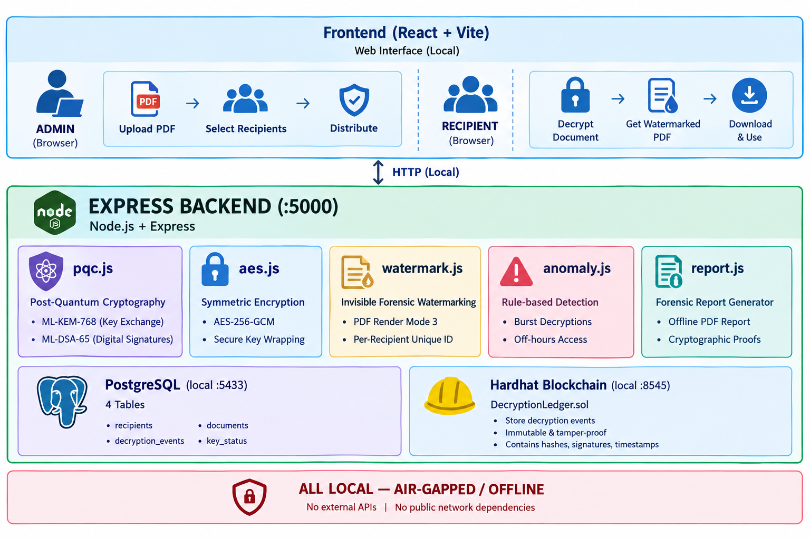

<p align="center">
  
</p>

# ProvenanceVault — Cryptographic Attribution and Immutable Decryption Provenance for Multi-Recipient Encrypted Document Distribution

> ProvenanceVault is an air-gapped, post-quantum cryptographic system that definitively attributes leaked documents to the specific recipient who decrypted them, using invisible watermarking and an immutable local blockchain ledger.

---

## 🛑 Problem Statement

**SIH26237 (Ministry of Defence — Indian Navy WESEE)**
When sensitive, classified documents are distributed to multiple authorized recipients, tracing the source of a leak is exceptionally difficult. ProvenanceVault solves this by ensuring that every decryption event creates a uniquely watermarked copy of the document, signs the event with the recipient's post-quantum private key, and permanently commits the proof to a local, tamper-proof blockchain ledger.

---

## ✨ Key Features

- **Post-quantum cryptography**: Implements NIST-standardized ML-KEM-768 for key exchange and ML-DSA-65 for digital signatures.
- **Per-recipient invisible forensic watermarking**: Each decrypted document contains a unique, invisible identifier (Render Mode 3) embedded in the PDF content stream.
- **Immutable local blockchain ledger**: All decryption events are permanently logged with cryptographic proof without relying on a public network.
- **Fully offline / air-gapped operation**: Zero external API calls or public network dependencies.
- **Key revocation with historical + current status tracking**: Revoke compromised keys instantly and prove cryptographically whether a key was valid at the exact time of decryption.
- **Rule-based anomaly detection**: Automatically flags suspicious activities like burst decryptions or off-hours access.
- **Exportable cryptographic forensic report**: Generate comprehensive, offline PDF reports for legal and investigative teams.

---

## 🛠 Tech Stack

| Component | Technology |
|---|---|
| **Frontend** | React + Vite |
| **Backend** | Node.js + Express |
| **Database** | PostgreSQL (local) |
| **Blockchain** | Solidity + Hardhat (local node) |
| **Cryptography** | `@openforge-sh/liboqs` (ML-KEM-768, ML-DSA-65), AES-256-GCM |
| **PDF Processing** | `pdf-lib`, `pdf-parse` |

---

## 🏗 Architecture Diagram



---

## ⚙️ Prerequisites

- **Node.js**: v18+
- **npm**: v9+
- **PostgreSQL**: Local installation (e.g., running on port `5433`)

---

## 🚀 Setup Instructions

1. **Clone the repository:**
   ```bash
   git clone <repository_url>
   cd SIH26237
   ```

2. **Install dependencies:**
   ```bash
   cd smart_contract && npm install
   cd ../backend && npm install
   cd ../frontend && npm install
   ```

3. **Set up PostgreSQL database:**
   - Create a database named `sih_ledger`.
   - Run the SQL schema provided in `backend/db/schema.sql` to initialize the tables.

4. **Configure Environment Variables:**
   Create a `.env` file in the `backend/` directory with the following variables (do not include the actual secrets, just configure them according to your local setup):
   ```env
   HARDHAT_RPC_URL=
   CONTRACT_ADDRESS=
   HARDHAT_PRIVATE_KEY=
   DB_HOST=
   DB_PORT=
   DB_NAME=
   DB_USER=
   DB_PASSWORD=
   PORT=
   ```

5. **Start Hardhat local node:**
   Open a new terminal and run:
   ```bash
   cd smart_contract
   npx hardhat node
   ```

6. **Deploy smart contract:**
   In another terminal, run:
   ```bash
   cd smart_contract
   npx hardhat run scripts/deploy.js --network localhost
   ```
   *Note the deployed contract address from the output and update `CONTRACT_ADDRESS` in your `backend/.env` file.*

7. **Start the backend server:**
   ```bash
   cd backend
   node index.js
   ```

8. **Start the frontend dev server:**
   Open a new terminal and run:
   ```bash
   cd frontend
   npx vite
   ```

9. **Open the application:**
   Navigate to the frontend URL (usually `http://localhost:5173/`) in your browser.

---

## 📖 Usage Flow

1. **Onboard recipients**: Go to the Admin Dashboard and generate post-quantum cryptographic identities and Ethereum wallets for your users.
2. **Distribute an encrypted document**: Upload a PDF and select specific recipients to distribute securely encapsulated copies.
3. **Decrypt as a recipient**: When a recipient decrypts their document, the system automatically unwraps the AES key, embeds an invisible forensic watermark, ML-DSA signs the event, and commits the record to the blockchain.
4. **Leak Investigation**: If a document leaks, upload it to the Leak Check module to extract the watermark, verify the on-chain signature, and cryptographically attribute the leak to the specific recipient.
5. **Download forensic report**: Generate and export an offline, air-gapped PDF report containing all cryptographic proofs and key status (historical and current).

---

## 🛡️ Security Design Notes

ProvenanceVault is built for the post-quantum era. Digital signatures are generated using the NIST-standardized **ML-DSA-65** algorithm. Because ML-DSA is not native to the Ethereum Virtual Machine (EVM), cryptographic verification occurs entirely off-chain in the Node.js backend. The local blockchain is utilized purely as an immutable, tamper-proof ledger to store raw signatures, timestamps, and document hashes as irrefutable evidence.

---

## 🚧 Known Limitations / Future Scope

- **Single-node local ledger**: The current architecture runs a local Hardhat node to fulfill the strict air-gapped requirement. A production deployment across multiple bases would require a multi-party consensus network (e.g., a private Quorum or Hyperledger Besu network).
- **Physical Exfiltration**: The invisible watermark survives digital text-layer extraction, but it does not survive analog screenshots or physical photography (this was acknowledged as out-of-scope for the Problem Statement).
- **Key Storage**: Recipient private keys are currently simulated and stored via local JSON keystore files. In a production environment, these would be securely managed within Hardware Security Modules (HSMs) or smart cards.

---

## 👥 Team

**Team CodeTitan**
- Haina KherKatary
- Divyanshi Verma
- Diya Shukla
- Abhishek Sahu
- Yuvraj Kumar Singh
- Aman Savita (Athiran)

---

## 📄 License

*For SIH 2026 evaluation purposes.*
